# Journey Hub features

[Install the Hub](README.md#install) · [Advanced configuration and maintenance](DEPLOYMENT.md)

Journey Hub reads saved data from your AzerothCore WotLK server. It does not control bots, train abilities, equip items, buy auctions or modify game records. Saves can lag behind in-game activity. Its groups, notes, preferences, history and journal are local to the Hub.

## Pages at a glance

| Page | What you can do |
| --- | --- |
| Dashboard | Save up to 32 groups of 1–10 characters, compare levels and quests, inspect shared/catch-up objectives and ready hand-ins, plan next actions, and view observed progress. |
| Playerbot Watch (Dashboard tab) | Watch up to 32 named characters, including ordinary characters, and keep local notes. The watch list is independent of saved groups. |
| Armory | Inspect a character's equipment, item details and skills, with optional local-client 3D appearance previews. |
| Gear Planner | Save combat roles and compare current equipment with owned, quest, crafted and vendor alternatives, including score explanations and group activities. |
| Inventory | Browse carried bags, personal banks and guild banks with item search and inspection. |
| Quest log | Browse active quests, completed history and the world catalogue; search names/IDs, filter class restrictions and inspect objectives, rewards and roster status. |
| What's Training | Browse class-trainer abilities and ranks, upcoming levels, missed training, learned abilities and saved requirements, with ability tooltips. |
| Professions | Inspect skill progress, recipes, reagents, carried material counts and group crafting opportunities. Rank-training indicators use saved skill and character-level requirements. |
| Auction House | Browse current realm auctions by house, category, rarity and level; inspect seller listings, stacks, bids, buyouts and current price distributions. |
| Journal | Write, edit, search and tag chronicles with dates, people, places and up to four PNG/JPEG screenshots per entry. Works independently of the game database. |
| SQL explorer | Browse permitted tables and run bounded, validated single SELECT queries against the character/world schemas. |
| Settings | Choose appearance and fonts, change SQL display limits and configure optional local-client model previews. |

## Groups, progress and planning

Create or edit groups under **Dashboard → Manage groups**. Each has up to ten distinct character names in your chosen display order. Saved selection is shared across roster-aware pages. Deleting a group asks for confirmation; it does not delete characters or journal entries. Keep at least one group once groups exist.

Playerbot Watch has its own roster and character notes. Missing characters and source outages are labelled instead of being replaced with sample data. New installations start empty.

Quest comparisons show active/shared/catch-up quests, objectives and hand-ins. **What should we do next?** adds grouped quest activities and advisory routes based on known locations and prerequisites. These are suggestions, not movement or bot commands. Activity history starts when the Hub observes changes; it cannot reconstruct earlier sessions or unsaved gameplay.

## Quest log

Choose **Active**, **Completed** or **All Quests**. Saved-group selection is shared with other pages; the separate **Playerbot Watch** choice uses the watched roster without creating a group. An explicit character link can open that character directly.

Search by name or quest ID. The class filter selects quests restricted specifically to that class; it is not a complete eligibility check. World-search pagination and counts apply after filters. Unused/deprecated titles are omitted. Faction crests use resolvable saved race restrictions and mandatory prerequisites; ambiguous restrictions remain unmarked.

Hover a quest title or focus it for group status; the explicit status button is also available. Quest names open the dashboard quest log in All Quests mode, with a separate ↗ link to Wowhead WotLK.

Rewards, required objective items, quest-starting items and provided quest-item references use the shared item tooltip. Item links retain Wowhead navigation. Completed history records hand-ins, not historical objective counters or reward choices.

## Item and ability tooltips

Item details share one tooltip style across equipment, Inventory, Gear Planner, professions, auctions and quest items. Hover or keyboard focus shows requirements, stats, effects, sockets, set descriptions, stacks and sell prices when available. Recipes can add cast time, tools and reagents. Saved equipment details retain applicable enchantments, durability and random-property labels.

Details come from server templates and generated metadata. Client-dependent formulas are labelled incomplete; these are not combat simulations or guarantees of active bonuses. Tooltips contain plain text. Database links remain on the page, and the Hub loads no Wowhead scripts or embedded pages.

## What's Training and professions

What's Training uses saved spellbooks/skills and server trainer definitions. **Coming Soon** covers the next two levels; other views include later ranks, missed training, saved checks that pass and learned ranks. Search by name/ID and enter a required level or range. Ability tooltips show available descriptions, costs, cast times, range, cooldowns and prerequisites.

It does not require the What's Training addon. Quest/talent/pet unlocks, scripts, discounts and unsaved changes can affect availability; base prices and explicit placeholders do not promise that a trainer will teach an ability.

Professions show saved skill caps, learned recipes, recipe requirements and carried materials. Orange training indicators flag a rank upgrade when its saved skill and level requirements are met, through Grand Master. Character badges and focusable tooltips expose the same information. The Hub never crafts or trains.

## Gear Planner

Choose a combat role for each group member; roles are stored locally and are not inferred from talents. Explainable, role-weighted stat comparisons cover already-owned gear, quest rewards, crafting and vendors. They are not item-level rankings, DPS predictions or best-in-slot guarantees.

Owned alternatives include selected-group accounts, additional characters explicitly named in groups/watch lists, and selected-group guild banks. Unrelated accounts are excluded. Soulbound items on other characters and opposite-faction transfers are excluded; account-bound transfers require the same account. Guild permissions and displaced donor equipment need checking.

Saved class/race restrictions, proficiencies, obvious unique-equipped rules and two-handed replacements are checked. Quest suggestions check resolvable prerequisites and quest-contact hostility; vendor suggestions exclude hostile or unknown-faction contacts. Reputation, stock, travel, scripts and unresolved effects can require manual review. Future candidates are limited to five levels above the character.

Group plans avoid double-counting shared item instances and flag competing recipients. Effort bands and beneficiary counts are advisory, not travel-time estimates. Unresolved effects are provisional and excluded from fully scored activity rankings. Full loot-source coverage, combat simulation and talent-dependent optimisation are not implemented.

## Inventory and Auction House

Inventory separates carried bags, personal bank and guild bank, with saved item inspection. The Hub never moves items or changes bank permissions.

Auction House provides the WotLK category tree, filters, price-first sorting, item tooltips and paginated seller listings. Choose Alliance, Horde, neutral or all houses; select an item for bids/buyouts/stacks and a current-stock price distribution. Escape returns to results. Expired auctions are excluded, prices display gold/silver/copper, and fractional unit prices round up.

Auctions are read only. No bidding, buying, price-history collection or external auction-service dependency is included. No saved group is needed to browse auctions.

## Journal

Write chronicles with titles, dates/in-world chronology, classifications, people/places and up to four PNG/JPEG screenshots. Search, sort, filter and paginate entries. Revision checks prevent overwriting conflicting edits while preserving the draft.

Character tags, exact Persons Concerned name matches and historical group tags support filtering. A group tag saves the name and membership at tagging time, so later roster edits or deletion do not rewrite history. Character matching is case-insensitive and does not confuse names such as Aster and Asteria. Existing text, revisions and screenshots are preserved when tags are edited.

Stories and screenshot bytes live in the independent local `journal.sqlite3`. The Journal needs no game connection or saved group. Back it up alongside the Hub's other local state.

## Appearance and rested XP

Settings offers Azeroth Forest, Icecrown, Horde Ember, Arcane Dusk, Stormwind Parchment and **Wrath of the Lich King** themes, plus Classic, Modern, Storybook and Tinker font presets. Wrath adds original frozen-citadel artwork, icy accents, steel panels and matching navigation states. Appearance previews immediately and saves across pages and future visits. Fonts use local system families, apart from the bundled licensed auction font.

Character cards show rested coverage as a percentage of the current level's XP requirement. The item-style rested tooltip explains coverage, bonus XP and the cap; keyboard focus and Escape are supported. Values above 100% are current-level equivalents, not exact predictions through later levels. Coverage is twice the server's stored bonus pool.

Offline values marked ≈ include estimates since saved logout. Online values use the latest database save. Missing data shows “Rested —”; capped characters show “Max level”. Default rates assume cap 1.5, offline multipliers 1 and maximum level 80; custom rates must be set in the [advanced configuration](DEPLOYMENT.md#settings-reference).

The realm/host label reads auth realmlist and the Hub machine's hostname; unavailable auth information does not block the dashboard. Multi-realm selection and friendly host labels are configurable.

## Limits and data sources

The normal connection reads saved character/world data; auth realm labels are optional. Generated DBC/SQL metadata supports detailed catalogues and tooltips. Optional 3D previews require your own compatible 3.3.5a client files. No client files or generated game assets ship in releases.

The optional HTTP quest-source adapter requires a compatible endpoint; no worldserver live module is bundled and it does not silently fall back to saved MySQL data. ASCII character-name validation, database-save lag, incomplete scripted eligibility and advisory scoring remain limitations. Linux/WSL is the tested Hub platform; native Windows/macOS, MariaDB, other cores/schema revisions and a second independent live realm are not certified.

SQL explorer accepts validated SELECTs only in permitted schemas. The Hub has no HTTP login or HTTPS; use localhost or a trusted private network. [Network and access details](DEPLOYMENT.md#access-and-security).

## Screenshots

Captured from the isolated preview on 31 October 2026 using the owner's Lemmings data with permission. These show a populated Hub; new installations still start empty. Every page except Settings is shown, plus the separate Playerbot Watch view.

### Dashboard

The Lemmings roster, rested-XP indicators, group totals and quest comparison.

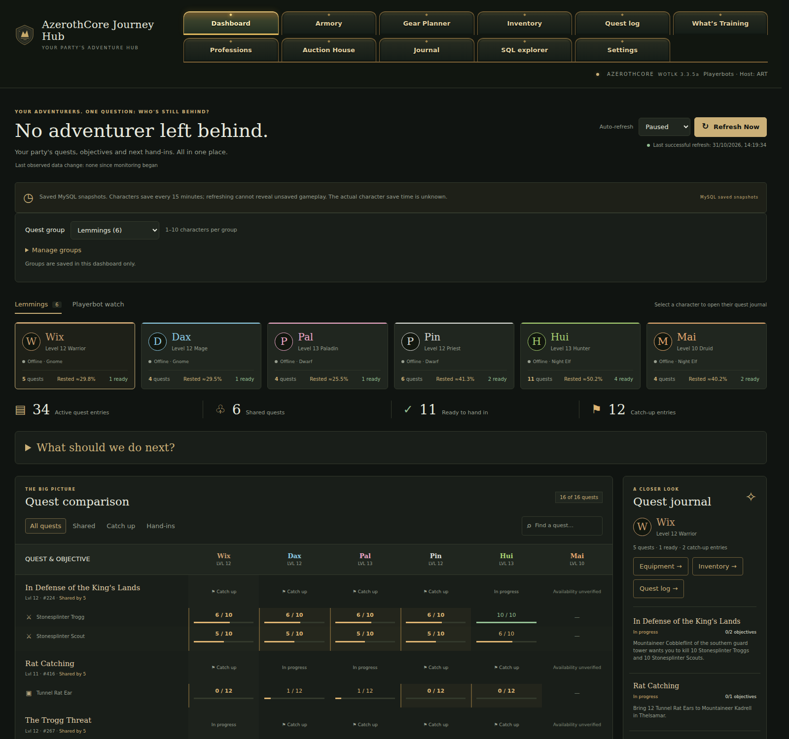

### Playerbot Watch

The Dashboard's independent watch roster and local character-note controls.

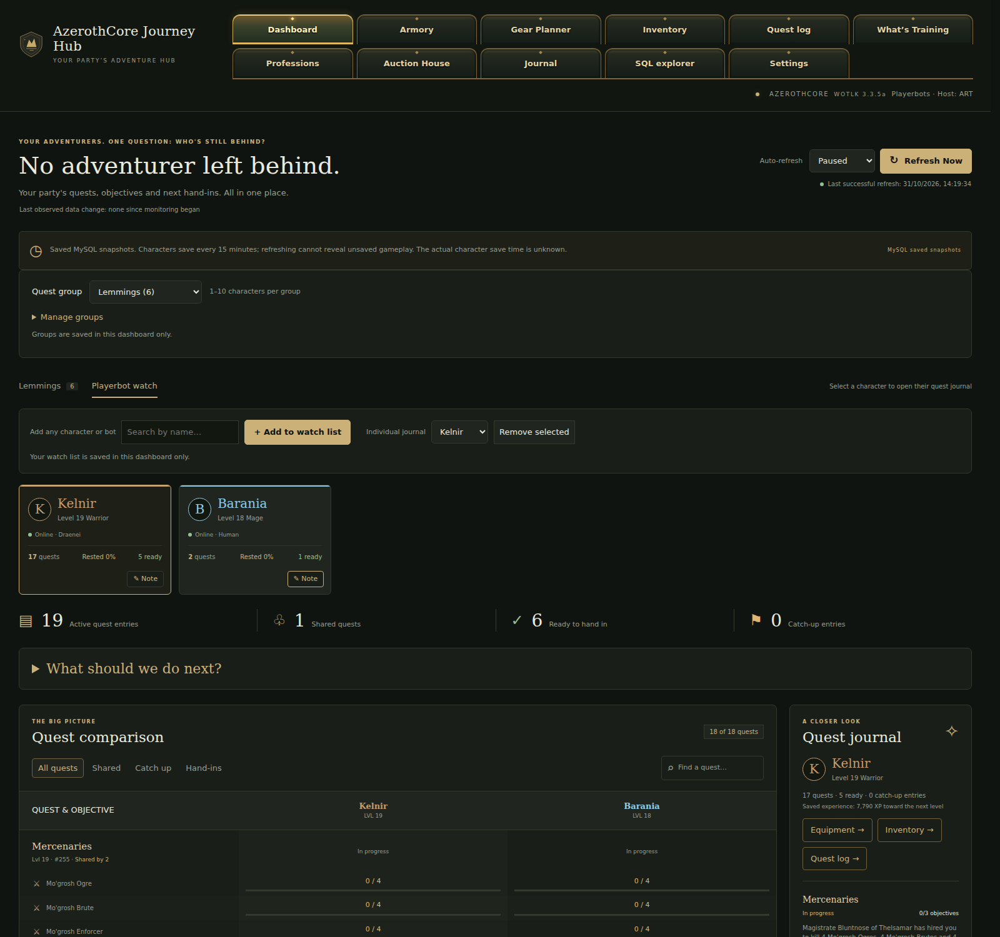

### Armory

Hui's saved equipment, 3D equipped preview and selected Ashwood Bow details. The optional 3D preview uses a locally supplied compatible game client.

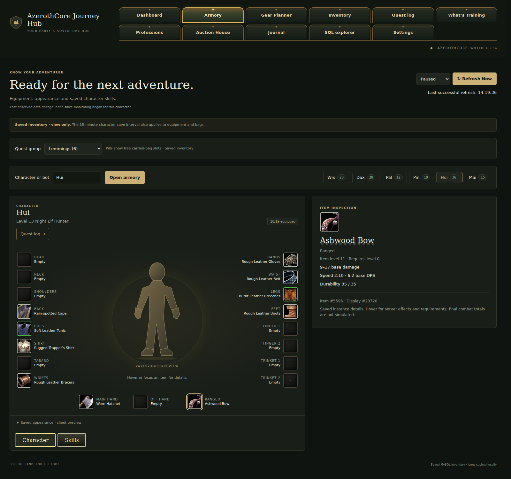

### Gear Planner

Suggested activities and equipment rewards that benefit several group members.

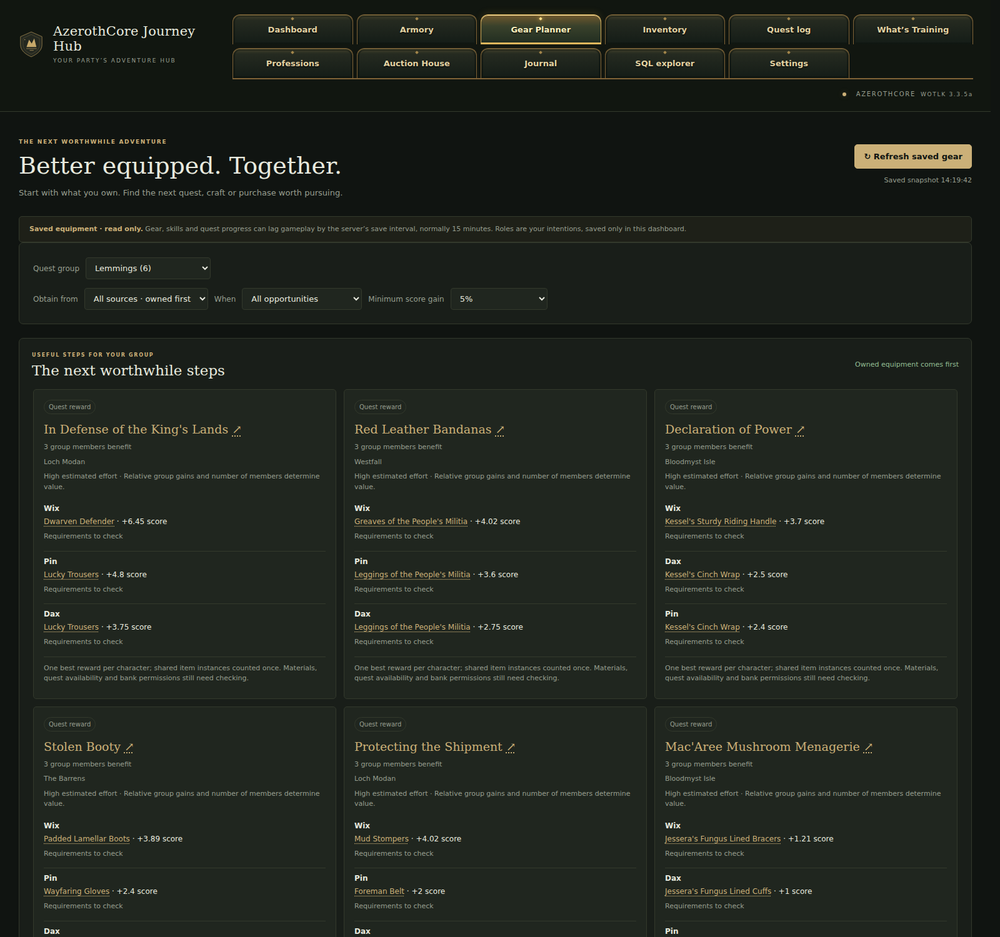

### Inventory

Hui's carried bags, saved item stacks and item inspection panel.

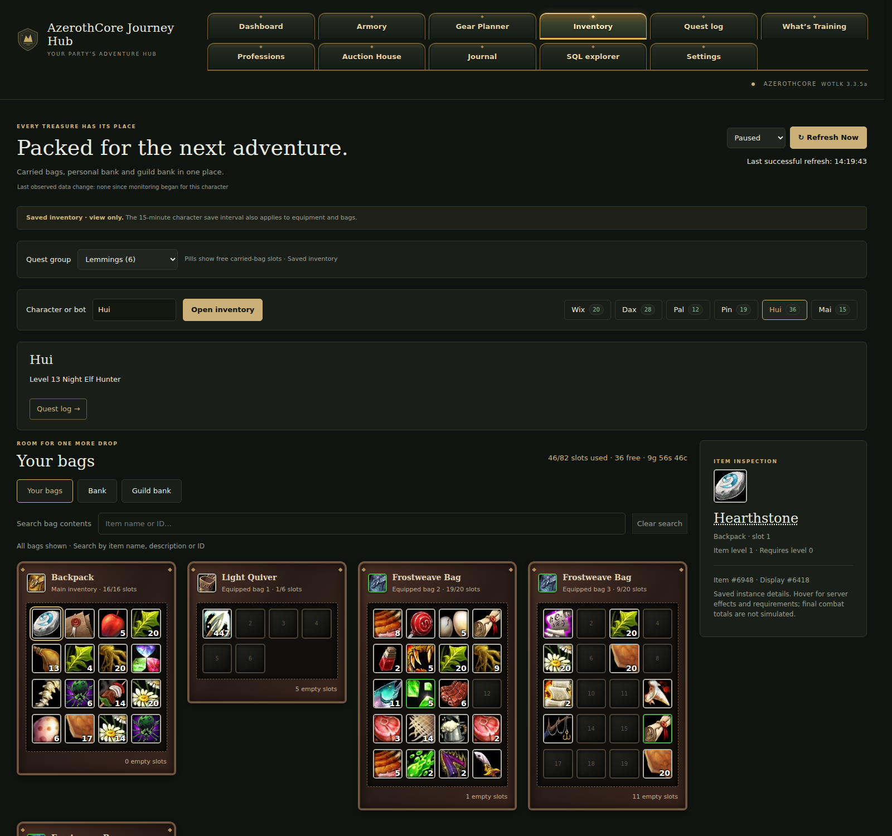

### Quest log

Hui's active quest list and the selected quest's objectives and rewards.

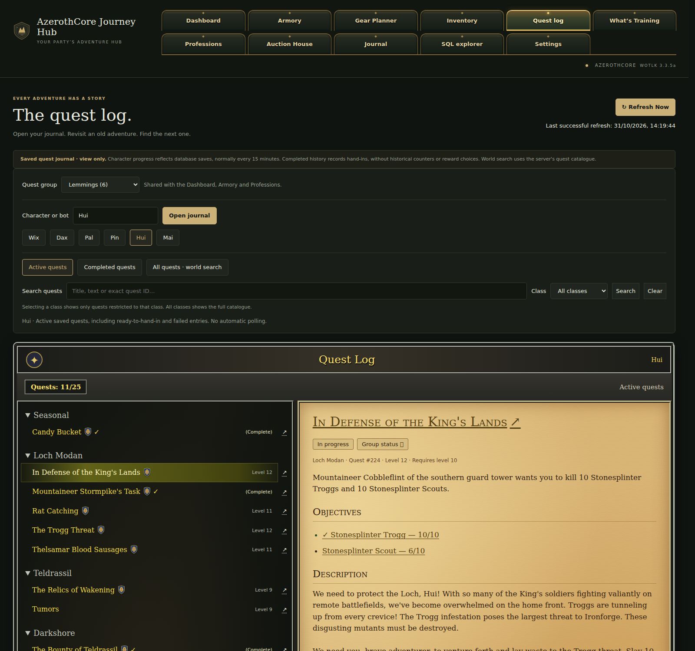

### What's Training

Hui's upcoming hunter abilities, grouped by required level.

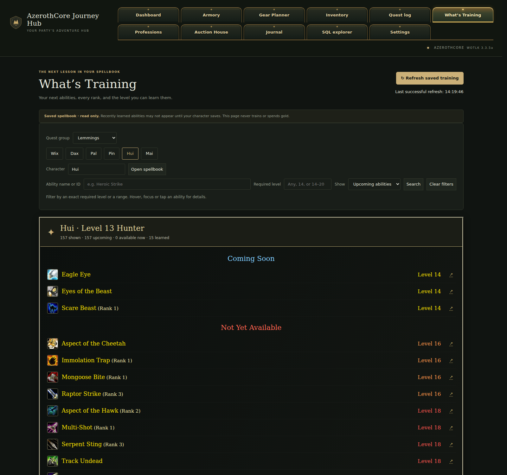

### Professions

Pin's saved Tailoring rank, learned recipes and selected recipe details.

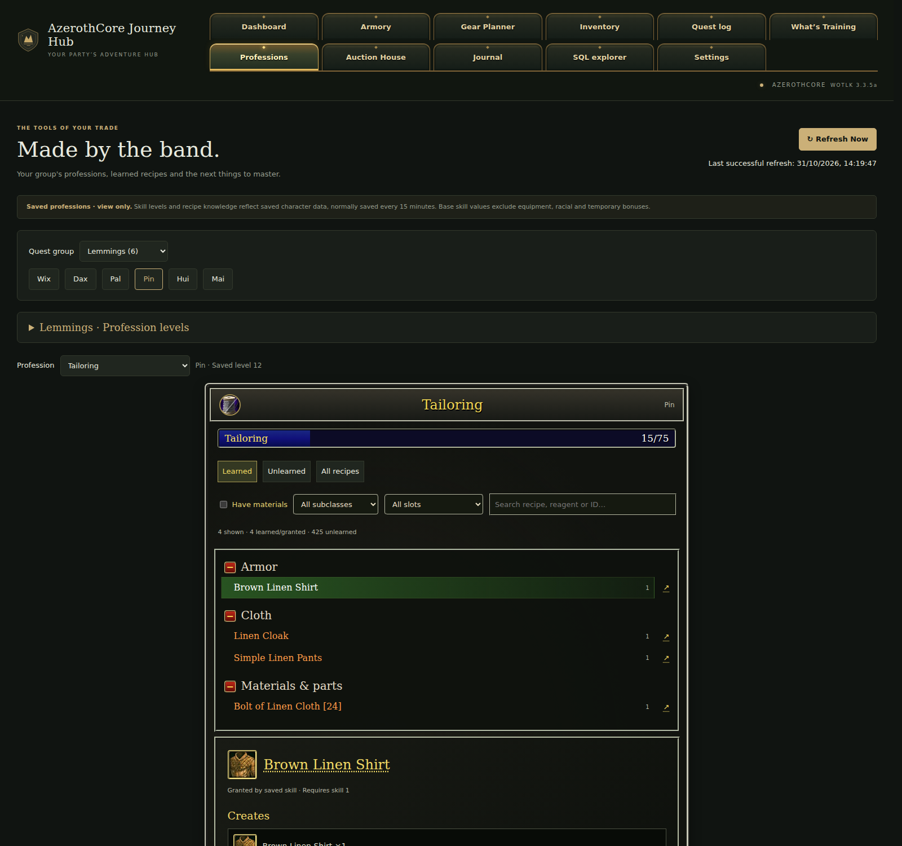

### Auction House

Current realm listings with item icons, prices, levels and available quantities.

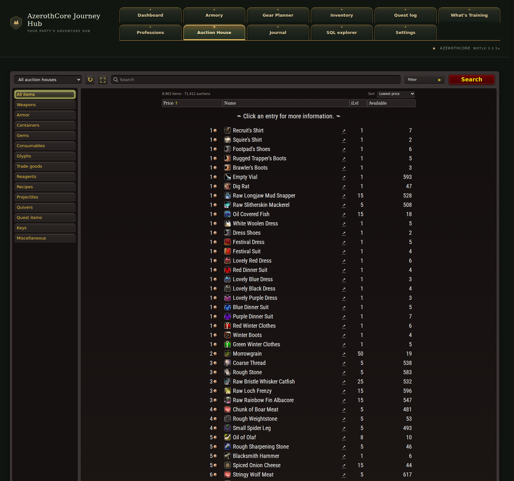

### Journal

The populated register and one of the Lemmings' recorded adventures.

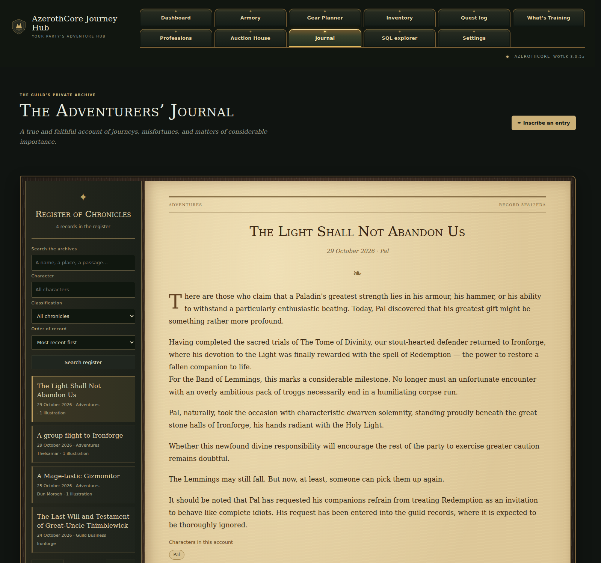

### SQL explorer

A read-only SELECT showing the Lemmings' saved names, levels, classes and online states.

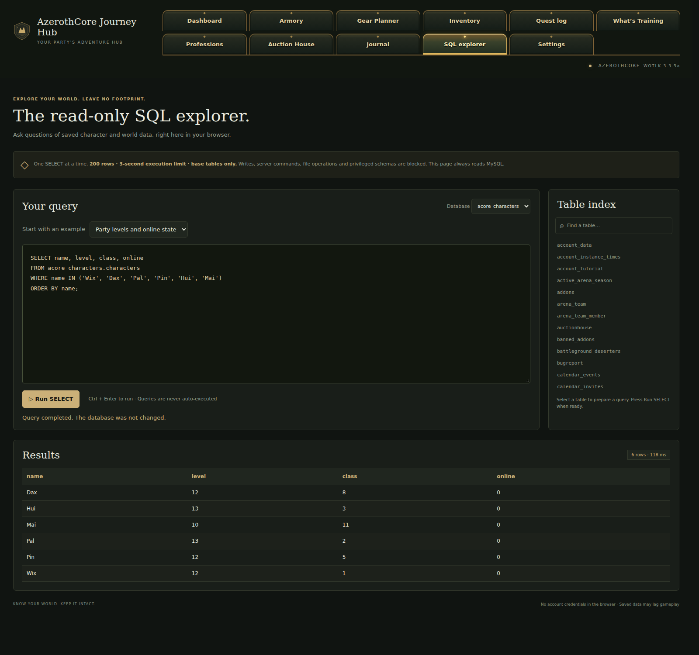
