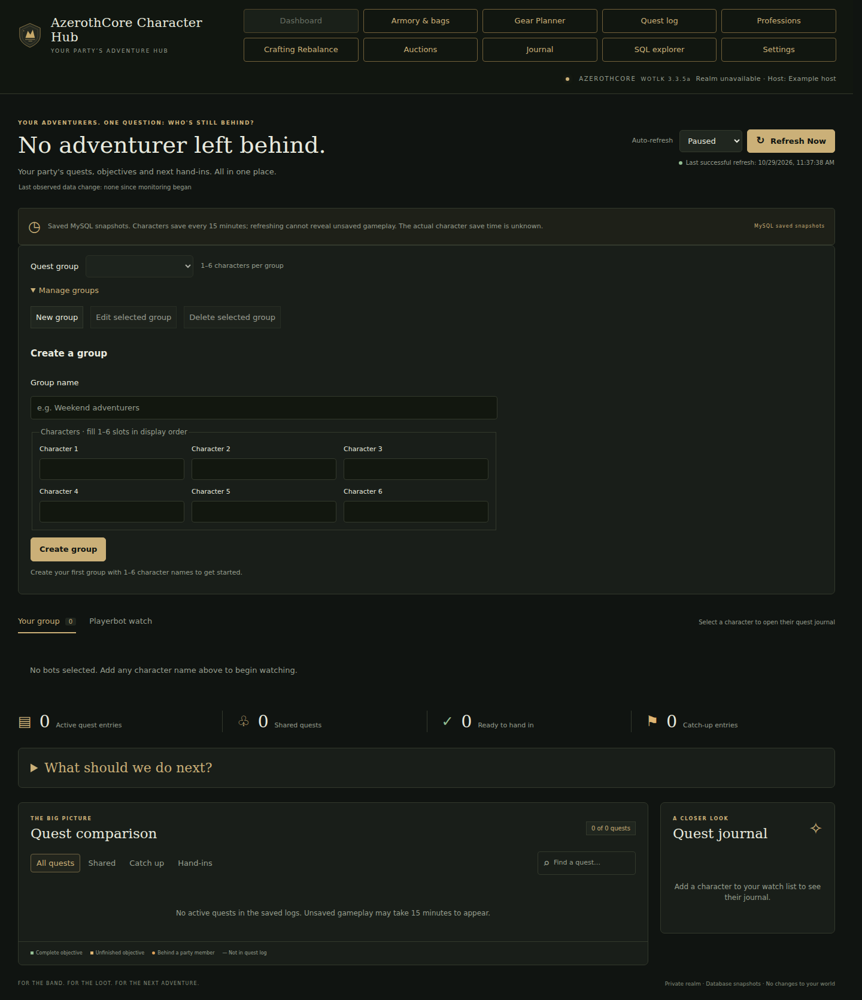
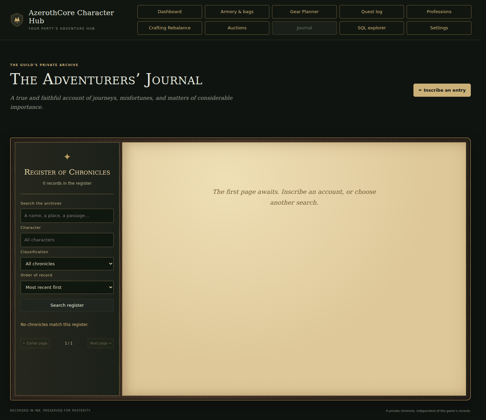
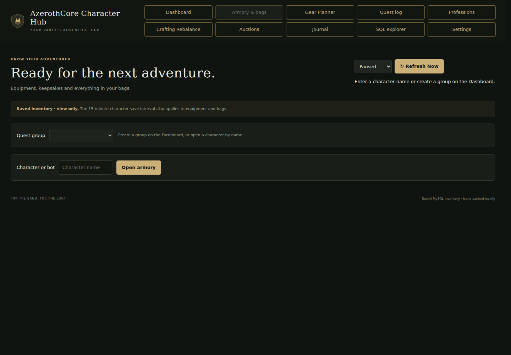
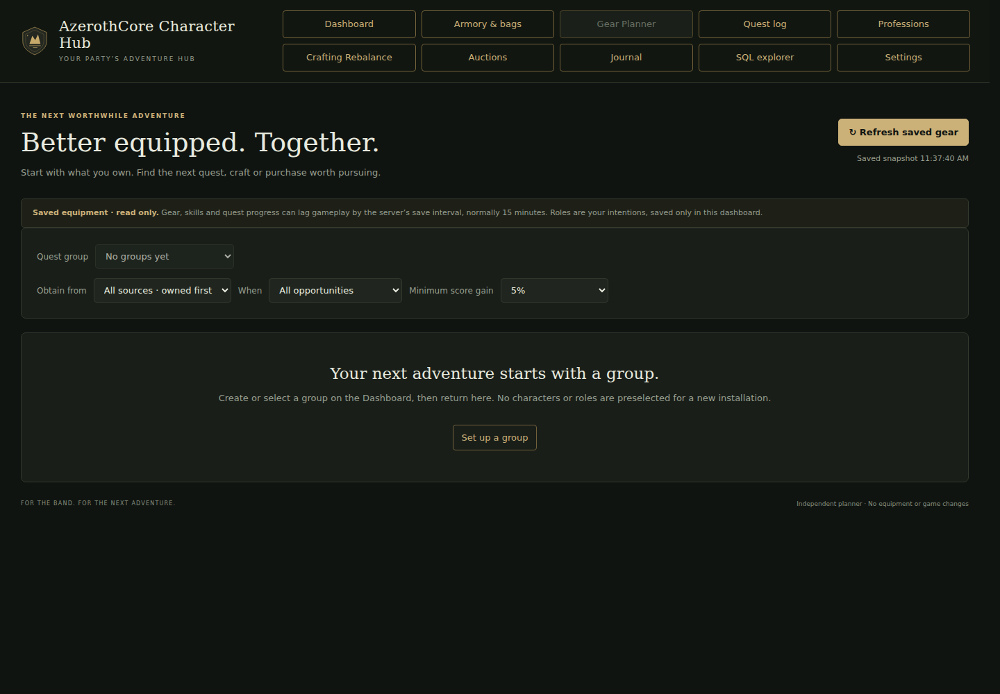

# AzerothCore Character Hub

## Overview

A read-only party dashboard for an AzerothCore WotLK 3.3.5a server. Compare quests across groups of
1–6 characters, browse quest logs and completed history, inspect equipment, carried bags, banks and guild
banks, browse professions and recipes, and track watched playerbots with notes. Includes group planning,
observed progress history and a restricted SQL explorer.

An independent **Adventurers’ Journal** provides parchment chronicles with editable titles, dates,
in-world dating, categories, people/places and up to four PNG/JPEG screenshots per entry. It does not read
or write the game database. Entries are searchable and ordered chronologically; conflicting edits are
rejected while retaining the draft. New installations contain no journal entries or screenshots.

The package starts **empty**: no characters, groups, watched bots, notes or history. It contains application
source and synthetic test fixtures, with no exported game database or generated game/client assets.

## Features and usage

Use the page navigation to choose an area. **Armory & bags** is followed immediately by **Gear Planner**;
**Settings** remains last. Shared saved groups determine the character shortcuts across pages. A fresh
installation is empty, including Journal. Features read your own server or local records as listed below.

| Area | Implemented controls and information | Source / limits |
| --- | --- | --- |
| Character Overview | Create, edit and select named groups; compare character levels, classes, zones, online status, active/shared/catch-up quests and ready hand-ins; manual/automatic refresh and compact character detail | Saved character/world database; 1–6 members per group, up to 32 groups; no fixed guild/account roster |
| Playerbot Watch | Search names, add/remove watched characters, open individual quest details, keep watch notes | Character database plus local watchlist/notes; up to 32 names, works for ordinary characters too |
| Party planning | Expand “What should we do next?” for hand-in priorities, shared objectives, catch-up actions, profession/material context and grouped routes | Current selected snapshot, quest dependencies/spawns/POIs; advisory routes, not navigation or bot commands |
| Activity history | View locally observed changes and per-character progress; filter history | Local activity.sqlite3; starts when observed, cannot reconstruct previous sessions or unsaved gameplay |
| Quest Log | Active, completed and All Quests world-search modes; text/ID/class filters, pagination, saved-group/watch selection; objectives, rewards, eligibility notes and roster status | Character quest status/reward tables and world quest catalogue; missing/ambiguous requirements are flagged |
| Armory & bags | Select a character; inspect equipment, stat/item details, carried bags, personal bank, guild bank, bag capacity and skills; optional 3D appearance and equipment previews | Saved inventories, guild membership, world items and generated DBC metadata; previews require a locally supplied compatible client |
| Gear Planner | Role selection, current equipment, owned/quest/crafted/vendor alternatives, score breakdowns, group activities and acquisition filters | Saved accounts/groups/guild banks, quest eligibility and metadata; read-only recommendations with unresolved effects flagged |
| Professions | Browse saved skill progress, learned recipes, item/reagent/tool requirements, material counts and group crafting opportunities | Saved skills/spells/inventories plus generated profession catalogue; never crafts or trains |
| Classic Crafting Rebalance | Global Classic-era equippable catalogue, filters, engineering panel, baseline/proposal comparisons, acquisition evidence, review decisions/notes and revisions | Generated local catalogue and crafting-reviews.sqlite3; engineering hypotheses, no game changes or deployment action |
| Auction Exchange | House/category/quality/level filters, search and sorting, paginated listings, bid/buyout/stack information and current unit-price distribution | Realm saved auctionhouse/items; no bidding, purchases or historical price collection |
| Adventurers’ Journal | Create/edit/delete chronicles with titles, dates/in-world chronology, classifications, persons/places, character/group tags and up to four PNG/JPEG screenshots; search/filter/sort/paginate; revision conflict protection | Independent local journal.sqlite3, no game connection needed; archive ships with zero records and zero screenshots |
| SQL explorer | Browse permitted tables and run bounded single SELECT queries, results and duration; settings control row/time/base-table restrictions | Character/world schemas only; validated SQL AST, read-only transactions; never a general SQL command terminal |
| Settings | Appearance themes/fonts, refresh/save-interval annotations and SQL display policy; LAN allowlist, model directory and deployment settings remain local | Local JSON configuration; does not modify server settings |
| Realm identity and rested XP | Realm/host header, optional realm selection; saved/rested coverage with offline estimates | Auth realmlist and character XP/logout values; estimates require matching server rate settings |

Known record types/IDs link to Wowhead WotLK. Quest names open the dashboard’s All Quests search;
a separate ↗ opens Wowhead. Tooltips remain plain and detail actions remain available.
The optional HTTP quest-source adapter accepts a compatible live endpoint and never silently falls back
to MySQL. No worldserver live module is bundled. See detailed feature notes below.

## Screenshots

Screenshots in `docs/screenshots/` show a clean installation only; no private character or journal data.






## Requirements and compatibility

- Linux or WSL, Python 3.12+, with `venv` and `pip` available.
- Docker access (or the direct MySQL connection described in DEPLOYMENT.md) to an existing, running **AzerothCore WotLK 3.3.5a** installation. This is not a standalone
  WoW server, a hosted data service, or a static site suitable for GitHub Pages.
- Character/world schemas default to `acore_characters` and `acore_world` (configurable). For Docker compatibility mode, the database container
  must provide the `mysql` CLI and `MYSQL_ROOT_PASSWORD` environment variable. Credentials are read inside
  that container and are not stored in this package or sent to browsers.
- The world container needs the standard DBC files at `/azerothcore/env/dist/data/dbc/` for metadata setup.

This adapter targets the installed AzerothCore schema; other cores or schema revisions may need changes.
Game queries run in read-only transactions. Settings change dashboard behavior, not game data.

## Installation

Extract the package or clone your copy of this source. Before setup/start, configure container names if
they differ from the defaults:

```sh
export CHARACTER_HUB_DB_CONTAINER=YOUR_DATABASE_CONTAINER
export CHARACTER_HUB_WORLD_CONTAINER=YOUR_WORLDSERVER_CONTAINER
./setup.sh
./start.sh
```

Setup installs the pinned Python dependency in `.venv` and generates item, quest and profession metadata
from **your** server. Preserve these environment variables when starting with different container names.
For app-only setup without Docker/assets, `./setup.sh --skip-assets` installs dependencies; generate metadata
later by rerunning setup. Professions require their generated catalogue; client previews are optional.

Open **http://localhost:8765**, expand the group setup area and create a named group using 1–6 of your
character names. Add bots separately under **Playerbot watch**. No database read is needed just to start
the empty dashboard. Stop it with Ctrl+C; no game services are stopped.

Saved character data normally updates on the server's character save cycle. History begins when the app
first observes your characters; it cannot reconstruct earlier sessions. Skills show saved base values,
excluding equipment/racial/temporary bonuses. Recipe browsing and material counts do not craft anything.

## Deploy to another machine or Docker environment

Copy `dist/azerothcore-character-hub-v0.1.0.zip` to the target machine, unzip it into a **new directory**,
and run the following there (Linux or WSL with access to that machine’s Docker daemon):

```sh
cd character-hub
python3 deploy.py --db-container YOUR_DATABASE_CONTAINER --world-container YOUR_WORLDSERVER_CONTAINER
bash start.sh
```

Find container names with `docker ps`. The deploy command installs dependencies and generates
metadata, including Gear Planner lookups, from the target server. It saves the container names in
local `deployment.json`, so later `bash start.sh` and metadata preparation commands use the same
server without repeated exports. Existing `CHARACTER_HUB_DB_CONTAINER` / `CHARACTER_HUB_WORLD_CONTAINER`
environment overrides still work; unset conflicting overrides before deploying. Use
`--skip-assets` for dependency-only setup, then rerun without it when the server is available.
A failed setup can be retried with the same arguments.

An optional explicit roster can be verified during deployment:

```sh
python3 deploy.py --db-container YOUR_DATABASE_CONTAINER --world-container YOUR_WORLDSERVER_CONTAINER \
  --members Characterone Charactertwo --group-name 'My adventurers'
```

Add `--guild-name 'My guild'` only if membership in that exact guild is required. Existing groups
are always preserved, and a missing character leaves a new installation empty. No roster is inferred.

Stop the dashboard before running deployment against an existing installation. Use a separate
extraction for each realm: do not copy another realm’s local JSON files, SQLite databases or `assets/` to
the new machine. Deployment refuses to replace a saved target with different containers, keeping
realm history and generated metadata separate. Docker context/environment selects the Docker
daemon; the script does not create, restart or modify game containers. Direct TCP connections, schema names and DBC paths are configurable; see [deployment reference](DEPLOYMENT.md).

## Local data and updates

Local state is stored beside the app in `groups.json`, `watchlist.json`, `watch-notes.json`, `settings.json`,
`client-models.json`, `network.json`, `deployment.json`, `activity.sqlite3`, `journal.sqlite3` and `crafting-reviews.sqlite3`. These are ignored by Git and omitted from release
builds, along with caches and logs. Back up your installation before updating. Stop the dashboard before
copying SQLite, or use SQLite's online backup API for each database. `journal.sqlite3` contains both stories
and screenshot bytes; preserve it independently of game-server backups and restores. Replace application source while retaining local state;
do not copy another installation's configuration over yours.

Optional model previews use your own legally obtained client files, configured through Settings. Client
models, icon caches and generated metadata under `assets/` are not included in public releases. Regenerate
metadata after changing the server/client data version.

## LAN access (optional)

Default startup listens only on localhost. Create an ignored `network.json` using **your own** addresses:

```json
{"listen":"0.0.0.0","allowed_hosts":["192.168.1.50"]}
```

Restart and open `http://192.168.1.50:8765`. For WSL2 NAT, run Windows PowerShell as Administrator and execute
the included `enable-lan.ps1 -LanAddress YOUR_WINDOWS_LAN_IP -Distribution YOUR_WSL_DISTRO`. It forwards only
the dashboard port and limits its Windows firewall rule to LocalSubnet. Rerun after a WSL address change.
Linux deployments need their own host firewall configuration.

There is no login or HTTPS: reachable LAN clients share settings, notes, groups and SQL explorer access.
Keep this on a trusted private network. Host/Origin checks, cross-site rejection and submission tokens remain
enabled; these are not user authentication. Do not expose it to the public internet.

## Build a clean package

```sh
python3 package_release.py
```

Outputs are `dist/character-hub/`, `dist/azerothcore-character-hub-v0.1.0.zip` and its SHA-256 checksum. The builder
uses an explicit source allowlist and fresh empty defaults; it never copies personal state or generated
game assets. It includes a file hash manifest. Upload the **contents** of the clean source folder to your
GitHub repository, rather than uploading a live installation directory.

`./start.sh` automatically rebuilds if source changed and starts one background source watcher. It rebuilds
the clean ZIP within a few seconds of edits, without reacting to character data changes. Its PID and log
are in `.run/package-watch.pid` and `.run/package-watch.log`. Stop it using the recorded PID if wanted;
starting the dashboard will start it again. `python3 package_release.py --watch` can also run it manually.
Maintainer instructions require a rebuild after changes, and the included GitHub
Actions workflow builds and tests a clean package on pushes and pull requests. This builds artifacts only;
it does not publish a site or automatically push your local work to GitHub.

Run unit tests with `.venv/bin/python -m unittest discover -s tests`. Browser checks require a separately
configured local Playwright installation and a test dashboard with disposable state.

## Licence

The source retains its existing **MIT License**; see [LICENSE](LICENSE). Retaining MIT for public publication is proposed for owner approval; see [licence proposal](LICENSE-PROPOSAL.md).
Third-party `mpyq` retains its BSD licence in `third_party/MPYQ-LICENSE`. SQLGlot is installed separately from
the pinned dependency. World of Warcraft assets and trademarks belong to their respective owners; no game
client files are distributed here.

### Auction Exchange

Open **Auctions** to browse saved auctions from your own AzerothCore realm. Select Alliance, Horde, neutral or all houses; search item names or IDs; filter by category, rarity and item level; and sort by price, stock or level. Select an item for paginated seller listings, stack totals, current bids and a current buyout distribution. Prices use copper internally and display gold/silver/copper (fractional unit prices round up). Variants share a base-item summary; listings flag random properties and enchantments. This page is read only and never places bids or purchases. It requires the standard `acore_characters.auctionhouse`, `item_instance`, `characters` and `acore_world.item_template` tables through the existing Docker database connection. No watch list or group setup is required.

The exchange uses local HTML/CSS/JavaScript and the dashboard’s existing item icon provider, with a local placeholder when icons are unavailable. There is no dependency on Undermine Exchange. Snapshot queries are cached for 10 seconds, expired auctions are excluded and price charts describe current stock, not historical prices. New installations contain no sample auctions or characters.

The exchange follows the compact classic auction interface: an expandable WotLK category tree, price-first results, sortable column headers and item tooltips. Choose a category or subcategory, then press **Search** to apply it. Armor categories include equipment slots; recipe rows show required profession skill. Select an item for its listings, then use **Back to results** (or Escape) to return. The toolbar includes refresh, full screen and level/rarity filters. The bundled Roboto Condensed font is licensed under the SIL Open Font License; its license is included in `third_party/RobotoCondensed-OFL.txt`.

The Quest Log’s **Quest group** selector uses the same saved group selection as the Dashboard, Armory and Professions. Opening the page selects the latest shared group; choosing a group saves it for the other pages and updates the character shortcuts and quest group-status tooltips. An explicit character link still opens that character. **Refresh Now** also reloads the shared selection, and browser Back/Forward restores it from the server. Without groups, enter a character directly or create your first group on the Dashboard.

The Quest Log’s group dropdown also has a **Playerbot Watch** roster. Saved groups show only their own members; the watch roster shows all watched characters (up to 32) without creating or changing a saved group. Its quest-status tooltip uses the same watch roster. The watch view survives refresh through its page URL; selecting a saved group still saves the shared group selection for the other pages.

Quest search includes an **All classes** dropdown. Select a class to combine text or ID searches with quests restricted specifically to that class; general quests and quests restricted to other classes are excluded. **All classes** keeps the full catalogue. This filter applies before pagination and also works in active/completed views. It checks class restrictions only, not level, race, prerequisites or other eligibility conditions.

Quest titles marked `<UNUSED>` or `<DEPRECATED>` are excluded from quest lists and searches before result counts and pagination are calculated. Faction-only quests display a small Horde or Alliance crest immediately after the title. Badges use saved race restrictions, including up to six explicit mandatory prerequisite links with no alternative exclusive group; ambiguous or unrestricted quests remain unmarked. Hover the quest title text for roster status; hovering row padding, faction icons or level labels does not activate that tooltip. Keyboard focus and the status button also remain available. Quest names open the dashboard’s All Quests view; the adjacent ↗ icon opens `https://www.wowhead.com/wotlk/quest=ID` in a new tab. No Wowhead scripts or embedded content are loaded by the dashboard.

Journal entries support clickable **character tags** and **group tags**. In the editor, pick names from the currently selected saved group, use **Tag whole group**, choose another known character from the standard dropdown, or turn suggested names from **Persons Concerned** into explicit tags. Tagged groups save their name and member list with the entry, preserving historical associations when a roster is later renamed, edited or deleted. Editing an entry keeps those memberships unless you explicitly remove or retag the group.

Click a character on an entry, or use the register’s **Character** field, to find entries with that direct tag, a tagged group containing that character, or an exact name mention in the existing **Persons Concerned** field. Character matching is case-insensitive and does not confuse names such as Aster and Asteria. Character filters combine with archive search, classification, chronology and pagination. Older journal text, revisions and screenshots are preserved; tagging needs no game-database connection and works without saved groups.

The journal editor’s **Another character** dropdown omits the selected group’s members and characters already covered by the entry’s character or group tags. Selecting a character enables **Add character tag**. If no other known characters remain, the dropdown is disabled; new names can still be entered in **Persons Concerned** and tagged from its suggestions.

### Gear Planner

Open **Gear Planner** to compare equipment for the shared selected group. Every member stays visible, including missing saved characters. Choose each character’s intended combat role once; roles are stored in dashboard-only `gear-planner.json`, independently of AzerothCore. No role is inferred from class or talents. New installations have no seeded groups, characters or roles. Group changes made on another page are picked up while the planner is visible, normally within two seconds.

This first release covers **already-owned equipment, quest rewards, crafting and vendor offers**. Already-owned alternatives come first. The search includes bags, personal banks and equipment on characters belonging to the selected group’s accounts, additional characters explicitly named in saved groups or Playerbot Watch, and the selected group’s guild banks. It does not search unrelated accounts. Soulbound items on another character are excluded; account-bound items require the same account. Items owned by an opposite-faction character are excluded, including account-bound items; neutral-auction-house transfers are not treated as practical upgrades. Guild withdrawals and displaced donor equipment are flagged for checking. Vendor offers must pass the receiving character’s faction check: opposite-faction hostile vendors and vendors with unknown faction data are excluded, while neutral merchants remain available. Saved reputation, travel, stock and other purchase requirements still need checking. Shared item instances are counted only once in a group plan, and individual alternatives identify competing recipients.

Scores are explainable role-weighted stat comparisons, not item-level rankings, DPS predictions or best-in-slot guarantees. The page shows current gear, stat changes, score contributions, acquisition links, recipe materials and source requirements. Comparisons enforce saved class/race masks, proficiencies and obvious unique-equipped restrictions; two-handed replacements include the lost off-hand. Future candidates are limited to five levels above each member. “Saved checks pass” is not live server confirmation. Unaccepted quests, vendor faction/stock/token costs, guild permissions, unresolved effects and other incomplete checks are labelled accordingly. Group activities rank relative gains and the number of beneficiaries against coarse effort bands (ready hand-ins, recipe knowledge, materials, affordability and token costs); these are estimates rather than travel times. Group activities show one best reward per member; alternative rewards and overlapping material requirements are not a simultaneous shopping list.

The planner reads server item definitions and the existing local profession catalogue. Prepare optional effect lookups with:

```sh
python3 prepare_gear_assets.py
```

This reads the world container’s DBC files plus spell/enchantment database overrides and writes only `assets/gear-metadata.json`. Use the existing profession-asset preparation instructions for recipes. Restart the **dashboard only** after preparing or updating these caches. Without them, basic equipment still works and affected comparisons are marked for review. These generated assets and role preferences are excluded from public packages.

Dungeon/world-drop acquisition, full loot-reference resolution, combat simulation, talent-dependent caps, full weapon-pair optimisation, set bonuses, proc/use effects and random-suffix scaling are later phases. Items with unresolved effects are shown as provisional alternatives and excluded from the fully scored group activity ranking. Crafting currently uses selected-group crafters and their carried materials; recipe acquisition, workstations and cooldowns can still require checking. Source catalogues cache for five minutes and saved comparison results for ten seconds. All game-database access is bounded and read only; the planner never equips, transfers, crafts, purchases or changes server configuration.

Planner quest rewards now check class/race restrictions, quest-giver and turn-in hostility using local server faction templates (including overrides), and complete prerequisite paths. Alternative `NextQuestID` paths use OR logic; mandatory negative exclusive groups require all relevant quests. Team/class/race quest conditions and referenced conditions are checked where resolvable. Neutral and unrestricted quests remain eligible. Quests with unknown faction contacts, missing prerequisite definitions or unresolved demographic references are omitted rather than suggested to the wrong class or faction. Other scripted availability requirements still need checking. Rerun `python3 prepare_gear_assets.py` and restart the dashboard after updating an older installation’s planner metadata.

Items, vendor NPCs, quests, recipes, quest contacts and other identified game records offer links to their Wowhead WotLK pages. Links open in a new tab. Lists that open dashboard details retain their existing action and provide a separate ↗ database link. These links load no Wowhead scripts or embeds; only records with a known type and valid ID receive external links.

Quest references open the dashboard’s All Quests world-search view for that quest; a separate ↗ icon opens Wowhead. Quest reward items offer the same icon, stat and sell-price tooltip as auction listings, including keyboard focus support.

### Realm and dashboard host label

The main page header shows the realm name from the connected database's
`acore_auth.realmlist` and the hostname of the machine running the dashboard.
The label refreshes once a minute. If the auth database has multiple realms,
start with the worldserver's configured RealmID, for example:

```sh
CHARACTER_HUB_REALM_ID=1 CHARACTER_HUB_HOST_NAME=MyHub bash start.sh
```

`CHARACTER_HUB_HOST_NAME` is optional: use it for a friendly machine label such as
MyHub when the OS hostname differs (including WSL hostnames). The default
is the dashboard OS hostname, not the remote Docker daemon's hostname.
If the realm cannot be read, the header says so without blocking the dashboard.
Neither option changes game-server configuration or saved dashboard data.

## Classic Crafting Rebalance

Open **Crafting Rebalance** for a global Classic-era equippable crafting catalogue, independent of character
selection. Search by item name/ID and filter by profession, equip level, slot, quality, type, assessment,
review decision and initial/future/endgame scope. A focused 22-item engineering assessment panel is available.
New installations have no generated catalogue or review decisions; the page explains setup without needing a group.

Prepare data from your own verified server targets:

```sh
python3 prepare_profession_assets.py
python3 prepare_crafting_assets.py
```

Both tools use bounded read-only game queries. The second downloads a pinned, SHA256-verified public CMaNGOS
Classic reference (about 13 MB) solely to establish positive item-era membership; it never imports that SQL.
To use a previously downloaded archive, supply `--classic-reference /path/to/ClassicDB_1_12_1_z2815.sql.gz`.
Generated files stay in `assets/` and are excluded from the public package. The Classic base reference can omit
later additions; absent IDs remain excluded/unresolved. Baseline statistics come from your WotLK server,
not reconstructed Vanilla values. Review the authored assessment guards if your server's baseline differs.

Each item shows separate original/proposed templates, exact differences, recipe/training requirements,
material and intermediate-craft evidence, acquisition scenarios and conditional comparators. Equip requirement
is not an acquisition estimate. Self-sufficient level bands are calibration hypotheses; trading and higher-level
support have separate assumptions. Loot references are traced with bounded source panels; their raw chances
are not effective drop probabilities. Faction, quest chains, reputation, travel, rare sources, effects and
material effort may require manual verification. Uncertainty is retained rather than replaced with a universal stat score.

Three small authored proposals are hypotheses only. The Handstitched Leather Pants proposal is explicitly held
from the initial 1–30 candidate set because its acquisition evidence is unresolved. Competitive/strong unchanged
findings remain useful records. No catalogue action crafts, equips or deploys an item, and no migration SQL runs.

Save **not reviewed**, **approved**, **rejected**, **needs adjustment** or **deferred**, with notes, at the review desk.
Decisions and revision history persist in dashboard-only `crafting-reviews.sqlite3`. Concurrent edits are rejected;
regenerating changed evidence preserves the previous decision and marks it stale. Approval is an item-review decision,
not permission to deploy. Back up this database through SQLite's online backup API while running, alongside
both existing databases. Never replace it with generated catalogue data.

Engineering checks:

```sh
python3 -m unittest discover -s tests -v
python3 package_release.py
# Optional, with the existing local Playwright tooling and generated catalogue:
PLAYWRIGHT_BROWSERS_PATH="$PWD/.qa-browsers" .qa-venv/bin/python tests/crafting_browser_check.py
```

Browser review tests use temporary storage and never write your saved decisions. Game-data pilots and production
deployment are separate work requiring explicit authorization, verified isolation and reviewed migration/rollback evidence.

### Rested XP on character cards

Cards show rested coverage as a percentage of the current level's full XP requirement. Hover the
rested figure for the XP amount, extra bonus XP available from eligible kills, and progress toward
the rested cap. Coverage is twice the server's stored bonus pool. Values above 100% are current-level
equivalents, not an exact prediction of progress through later levels.

Offline values marked ≈ estimate rest earned since the saved logout timestamp; online values use
the latest database save. Missing data displays “Rested —”; maximum-level characters display “Max level”.
The calculations default to AzerothCore's rates: cap 1.5, offline rest rates 1, maximum level 80.
For customised servers, set `CHARACTER_HUB_REST_MAX_BONUS`, `CHARACTER_HUB_REST_OFFLINE_IN_TAVERN_OR_CITY`,
`CHARACTER_HUB_REST_OFFLINE_IN_WILDERNESS`, and `CHARACTER_HUB_MAX_PLAYER_LEVEL` in the dashboard environment
to match worldserver, then restart the dashboard. The dashboard does not automatically discover server
configuration overrides. Optional live providers must supply the rested fields to display this information.

## Configuration

See [DEPLOYMENT.md](DEPLOYMENT.md) for every connection/environment setting, JSON configuration,
direct SELECT-only credentials, custom schemas, optional metadata, listener setup and startup commands.
The distributable is a runnable Python application with its static frontend; initial setup downloads the
pinned Python dependency. No frontend compiler or published container image is required.

## Database access and security

[DEPLOYMENT.md](DEPLOYMENT.md#access-and-security) describes schemas/tables, least-privilege grants,
read-only game queries, local writes and network boundaries. No database migration or game write is
part of this release. Local JSON, all SQLite databases, generated game/client assets, logs, backups and
private tool directories are excluded by the explicit packaging allowlist.

## Troubleshooting and updates

Follow [troubleshooting](DEPLOYMENT.md#troubleshooting) and [backup/update instructions](DEPLOYMENT.md#updates-and-backups).
Preserve every local state file, especially the independent journal and screenshot database.

## Development

Use Python 3.12+, `bash setup.sh --skip-assets`, then `.venv/bin/python -m unittest discover -s tests`.
Run `python3 package_release.py` after changes. It creates a versioned ZIP, SHA-256 checksum and
per-file source manifest. Tests use temporary stores and synthetic fixtures. Optional Playwright browser
checks need a separately installed browser/tooling. Source, runtime and the clean release use the same
bundled HTML/CSS/JavaScript; no npm build is necessary. See [audit](AUDIT.md), [changelog](CHANGELOG.md)
and [validation](RELEASE_VALIDATION.md) for scope and evidence.

## Limitations and future enhancements

Group and watch limits, ASCII character-name validation, save-cycle lag, optional generated catalogues,
client-model requirements, advisory scoring and no HTTP authentication remain current limitations.
Native Windows/macOS, MariaDB, other cores/schema revisions and a second independent live realm have
not been certified. Future work may add packaged containers, broader adapters, more complete planner
effect/loot resolution and server-side live support; these are not implemented capabilities.

The workflow template in `.github/workflows/package.yml` is scoped to this application. To enable it
in a monorepo, an owner must copy it to the repository root workflow directory. Private release ZIPs
can also be downloaded from this application's `releases/` directory on the delivery branch.
